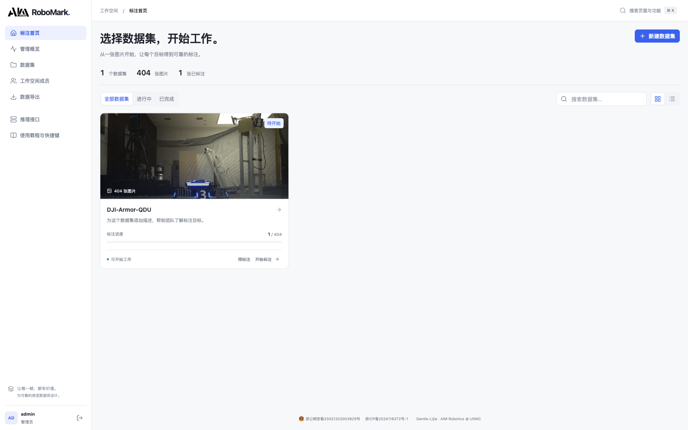
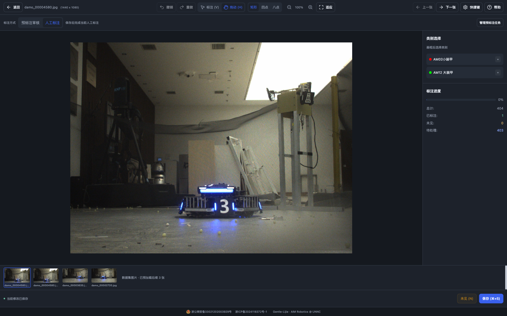
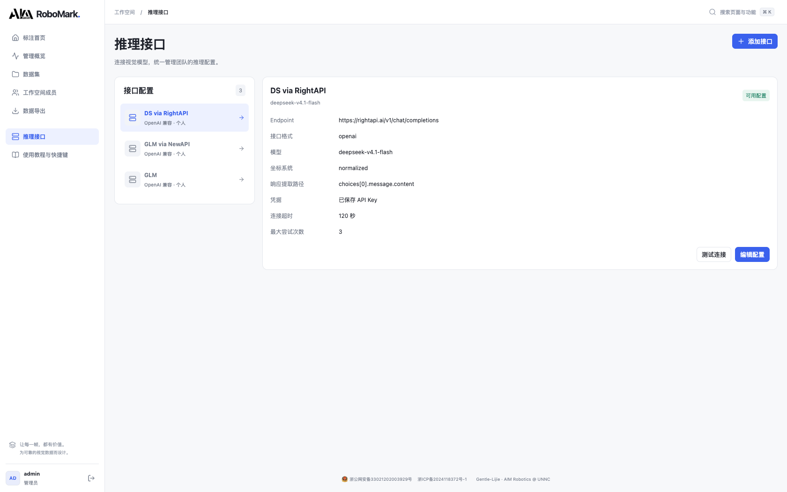
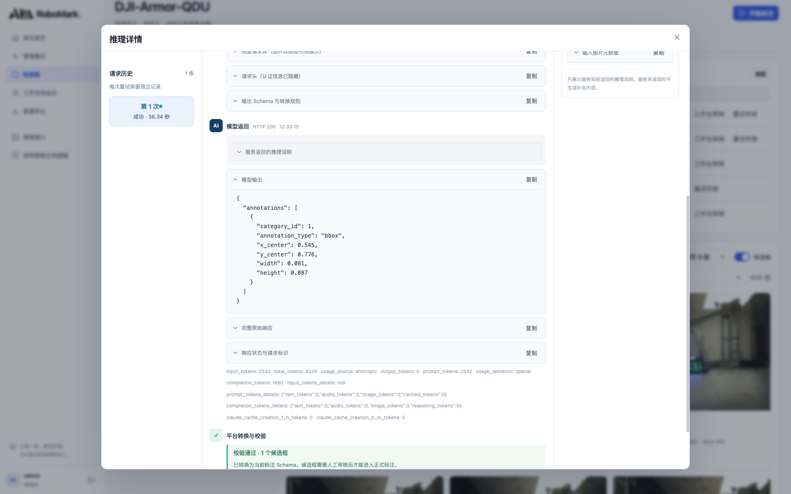

# 【工具开源】RoboMark：数据管理、AI 预标注、人工审核到训练集导出，一套网页搞定

各位 RMer 大家好，这里是宁波诺丁汉大学 AIM 战队。最近把我们做的一套图像标注工具整理了一下，叫 **RoboMark**，分享出来给有需要的队伍。

做视觉的同学应该都不陌生：收了一批图，先找目录、建类别；标到一半想用模型跑个粗标，又去改脚本、处理输出格式；跑完发现有漏框和错框，还得换回标注软件逐张修；最后再写脚本分训练集、验证集。一圈下来，模型还没开始训，时间先花在搬数据上了。

RoboMark 想解决的就是这些中间环节。**把数据集导入、人工标注、模型批量预标注、结果审核和导出放在同一个网页里**，队里部署一份，其他人打开浏览器就能用。

先放仓库，代码和使用文档都在这里：

**GitHub：https://github.com/unnc-aim/RoboMark**

项目采用 MIT 协议，欢迎直接用，也欢迎按自己队伍的习惯改。


*图 1：线上 DJI-Armor-QDU 数据集的一轮真实预标注结果。候选框、处理状态、审核状态和推理用量在同一张卡片里，点进去就能继续审核。*

## 一、先说它能做什么

RoboMark 是一套可以自己部署的 Web 标注平台。一个数据集从进来到导出，大致是下面这个流程：

**图片目录 → 扫描导入 → 配置类别 → 人工标注 / 模型预标注 → 人工审核 → 导出训练数据。**

如果只想手工标图，不需要先配模型，也不需要 GPU。建好数据集和类别，直接进工作台就能开始。

如果已经有视觉推理服务，可以接上来批量生成候选框。接下来检查和修框仍然在原来的工作台里完成，不用先把模型输出下载下来，再导入另一套软件。

目前主要功能如下：

| 环节 | 已有功能 |
| --- | --- |
| 数据管理 | 多数据集、服务器目录扫描、图片预览、进度统计、启用 / 停用 |
| 类别管理 | 类别颜色、快捷键、排序、批量导入、参考图片模板 |
| 人工标注 | 矩形、四点 / 八点构造四边形、拖动调整、缩放平移、撤销重做、图片队列 |
| 模型接入 | vLLM / OpenAI 兼容接口、自定义 HTTP JSON、字段映射、坐标转换、连接测试 |
| 批量预标注 | Prompt、先抽样再全量、后台执行、任务进度、取消、失败重试 |
| 结果审核 | 候选框叠加、状态筛选、修改与补画、草稿、通过 / 驳回、空结果确认 |
| 排查问题 | 单图请求历史、模型原始响应、转换结果、错误信息、Token 和 TPS |
| 导出与管理 | YOLO / Darknet / COCO、训练集划分、ZIP 下载、账号权限、成员贡献统计 |

功能列得比较多，下面挑实际用起来比较有感的部分展开。

## 二、先放实际结果：已有数据，直接跑一轮看看

本文截图来自我们部署在服务器上的版本，使用的是线上已有的 `DJI-Armor-QDU` 数据集，共 **404 张图片**。不是为了截图临时填进去的空壳数据，也没有用页面里的 Mock 示例冒充识别效果。

截图展示的全量批次是 `#4`，调用的模型为 `glm-5.3-flash`，任务是找出图中的 RoboMaster 装甲模块，并区分小装甲和大装甲。

这一轮的执行情况是：

- 404 张图片全部走完处理流程；
- 385 张成功产出候选结果；
- 19 张处理失败，单独保留在失败队列中；
- 成功结果继续等待人工审核。


*图 2：预标注任务页。左边配置接口、目标类别和 Prompt，右边查看抽样 / 全量批次，下面直接看图片结果。*

这里的“成功”指请求、结果转换和校验成功，**不代表框一定标对，更不是识别准确率**。404 / 404 也只表示处理流程已结束，其中仍然可以包含失败图片。

从图 1 能看到，不同图片返回的候选框数量并不一样。模型可以先帮我们把一批图跑出来，但框得是否贴合、类别是否合理、有没有漏掉侧面的装甲，最终还是要人看。我们没有做“几倍提效”的对照计时，所以这里也不给一个拍脑袋的效率数字，直接展示已有结果和后续怎么处理。

## 三、数据集和类别先管好，后面少返工

### 图片在服务器上，成员在浏览器里干活

RoboMark 的数据集基于后端能读取的图片目录。把图片放到服务器或挂载盘上，创建数据集时选择对应目录，再扫描导入，就可以在页面中浏览。

这里选的是**服务器上的目录**，不是浏览器自动读取每位队员的本地硬盘。对队内共用的标注机来说，这样比较直接：图片存一份，大家访问同一个工作空间，不用每个人再下载一遍数据集。



*图 3：首页展示已有数据集、图片数量和正式标注进度，可以直接进入预标注或标注工作台。*

首页和数据集页面能看到进度，也能查看图片。数据集多起来之后，可以搜索、切换网格和列表视图；数据集暂时不用时也可以停用。

### 类别、颜色、快捷键和参考图放在一起

类别管理支持逐个添加，也支持从文本批量导入，或者从其他数据集导入已有类别。类别可以设置颜色、快捷键和顺序，也能上传参考图片模板。数据集导入方式提供 YOLO、DJI ROCO 和 RC2026-wulin 等选项，具体配置见仓库文档。


*图 4：线上数据集使用的小装甲 / 大装甲类别。颜色、快捷键和模板入口都在同一页。*

参考模板这个功能比较朴素，但带新人标图时很有用。比如装甲板到底按什么边界框、某一类目标长什么样，可以给一个共同的参照。比起群里发完一张图之后再往上翻，直接在类别里找会省事一些。

当然，类别名字和模板只是辅助，标注规范还是要先说清楚。尤其是准备合并不同来源的数据时，类别含义、编号和框的范围最好先统一。

## 四、人工标注这部分，常用操作尽量做顺手

不接模型时，RoboMark 就是一套普通的图像标注工具。

工作台里有矩形、四点和八点三种工具。四点 / 八点用于构造四边形，其中八点方式通过边线交点确定顶点。画完可以选类别，也能移动、调整和删除已有框；滚轮缩放，空格拖动画面，撤销和重做也都有。



*图 5：人工标注模式。画布、类别、已有标注和图片队列在同一屏，常用操作不用来回翻页面。*

几个高频操作有默认快捷键，也能在工作台里调整：

| 操作 | 默认快捷键 |
| --- | --- |
| 保存 | Ctrl / ⌘ + S |
| 撤销 / 重做 | Ctrl / ⌘ + Z / Ctrl / ⌘ + Shift + Z |
| 删除选中框 | Delete / Backspace |
| 标注 / 拖动模式 | V / H |
| 缩放 / 平移 | 滚轮 / 空格拖动 |
| 查看快捷键帮助 | ? |

底部有图片队列，能回看前面标过的图，后续图片会做预加载。类别快捷键也可以自己配置，不用被固定的一套按键绑住。

需要说明的是，四边形标注工具不等于已经支持完整的 YOLO-Pose 训练流程。**当前导出主要面向检测框数据**；如果需要特定的关键点定义和 Pose 标签格式，仍然要按训练方案补对应的转换，不能看到“四点”就直接当成某一种 Pose 格式。

## 五、模型接入配一次，后续数据集可以复用

预标注并不绑定某一家模型服务。现在支持两类接法：

- **vLLM / OpenAI 兼容接口**：配置完整 Endpoint、模型名和认证等参数；
- **自定义 HTTP JSON**：按自己的服务定义请求模板、响应提取路径、字段映射和坐标规则。



*图 6：线上已保存的推理接口配置。接口配置可以跨数据集复用，认证凭据不会在概览中直接展示。*

如果队里已经有自己的推理服务，可以按它的返回结构做适配；如果是自己封装的检测模型，也可以接成 HTTP 服务。这里需要对齐请求与输出格式，**不是直接拖一个 `.pt` 文件上来就能跑**。

接口配置里可以处理像素坐标、归一化坐标等差异，避免每换一个服务就去改一份前端代码。配置支持跨数据集复用，管理员也可以维护共享配置。想让同一队伍里几个数据集用同一套服务，就不用反复填地址、模型和认证信息。

保存前后都能做连接测试，页面会显示检查结果、HTTP 状态和耗时。不过，连接通了只能说明服务基本可用，不能证明它已经能正确完成装甲板标注，所以后面仍然建议先抽样。

## 六、先抽几张，调好 Prompt 再全量跑

批量预标注的操作比较直接：选接口、选目标类别和输出形状、填写 Prompt，然后先跑几张样本。确认框的位置和分类大致符合需求，再对整个数据集运行。

线上这一轮 Prompt 的重点是装甲板的结构和边界，大意是：

> 检测 RoboMaster 机器人的装甲模块，按小装甲和大装甲分类。框应包含左右灯条和中间数字面板，贴合面板边缘，排除地面反光、顶部灯具和细长装饰灯带，不要只框其中一根灯条。

这类描述不能保证模型不会出错，但它至少把“我们想标什么”说清楚了。换到无人机、整车或其他目标时，也可以按同样的方式说明目标特征、边界和需要排除的东西。具体表现仍然取决于模型和图片。

Prompt 调了几轮之后，容易出现一个问题：上一版在哪个批次里来着？为此做了历史 Prompt 搜索，可以查看当前数据集的历史，也可以复用自己其他数据集里用过的内容。


*图 7：历史 Prompt 可以搜索、预览后再填入。批次列表里也有直接复用入口，不用手动从任务记录中复制。*

复用之后仍然可以继续修改，填错也能撤销这次填充。历史里保留原有内容，方便回看不同批次到底用了什么要求。

全量任务由独立 worker 在后台执行，**关闭页面不会终止任务**。队员不需要挂着浏览器等几百张图片跑完，再打开时还能看进度。

任务支持取消、失败重试，也保留每张图的执行状态。某几张失败了，可以只处理失败项，不用让整批成功图片陪着重跑。任务进度存放在数据库里，并有租约恢复机制；这部分是为长任务准备的，实际部署时仍然要让 worker 正常运行。

## 七、粗标之后怎么修，是我们比较在意的一段

模型跑完之后，批量结果页会把候选框直接叠在缩略图上，可以按执行状态、审核状态、是否有候选框筛选。

先在一屏里扫一眼，通常就能挑出一些需要重点看的情况：明显多框、只框到一部分、某张图突然没有候选，或者请求失败。点开图片，就是审核工作台。


*图 8：候选框以虚线显示，正式标注以实线显示，可以分别开关图层。修改、补画和审核都在同一个工作台里完成。*

审核和人工标注共用画布，不用重新适应另一套操作。候选框位置不对就拖动调整，类别不对就改类别，误检就删掉，漏检就自己补画。

这里有个特意分开的操作：**保存草稿和审核通过。**

- **保存草稿**：把这张图改到一半的结果存下来，之后接着看；
- **审核通过**：确认这一张的候选结果可以进入正式标注；
- **驳回**：保留这张结果被否决的状态；
- **空结果确认**：模型没有给出目标时，由人确认这一张确实没有目标或没有新增目标。

在审核模式下，Ctrl / ⌘ + S 只保存草稿，Ctrl / ⌘ + Enter 才是通过并到下一张。单纯切到下一张，不会顺手把上一张当作已经验收。

已有正式标注也会保留，审核通过的新框是在它的基础上追加。重复通过有检查，避免同一个结果被反复导入。候选框、草稿和正式标注各有自己的状态，**导出时只读取正式标注**。

这个区分看起来多了一步，但能避免很常见的情况：模型刚跑出一批粗框，大家还没看完，另一位队员已经把它们导出拿去训了。

## 八、某一张出问题，能看到它到底发生了什么

接模型最烦的情况之一，就是页面只告诉你“失败”，剩下自己去服务器翻日志。RoboMark 给每张图留了单独的推理记录，按请求历史查看：

- 当时发送的 Prompt 和图片信息；
- 实际请求内容及隐藏认证信息后的请求头；
- 模型返回的原始内容；
- 服务实际返回的推理说明（如果有）；
- 平台提取、转换和校验后的候选结果；
- HTTP 状态、耗时，以及具体错误信息。


*图 9：线上真实请求记录，可以从输入一路看到服务返回，并对照右侧的图片预览。*



*图 10：模型原始输出和平台转换结果分别保留。遇到“请求成功但框不对”的情况，可以分清是模型给错了，还是输出格式和坐标规则没有对齐。*

同一张图片重试时，会保留之前的尝试，不会把老记录覆盖掉。对于失败或等待自动重试的图片，也可以单独立即重试。

图片卡片还会显示输入 / 输出 Token 和 TPS，便于对一轮任务的调用量与等待情况有个数。用量来自服务返回，缺少记录时显示 `—`。这里的 TPS 按请求阶段耗时估算，包含排队和等待首 Token 的时间，**不能直接当成模型纯解码速度做性能排名**。

它不是一套完整的模型评测平台，但调接口、看慢请求、检查某一张为什么失败时，至少不用先离开当前页面。

## 九、审核完再导出，格式和数据划分一起处理

目前支持三组常用导出格式：

| 格式 | 导出内容 |
| --- | --- |
| Ultralytics YOLO（YOLOv5/v7/v8） | 图片、归一化框标签、`data.yaml`，按 train / val / test 组织 |
| YOLO Darknet | 类别文件、数据配置、分割清单和对应图片标签 |
| COCO JSON | 对应图片目录和各分割的标注 JSON |


*图 11：导出时选择数据集、格式和训练 / 验证 / 测试比例，生成 ZIP 下载。*

是否包含未标注图片可以自己选择。但候选结果和审核草稿不会混进正式训练标签，前面没有确认的框，不能靠“导出”这一步自动变成正确标注。

训练 / 验证 / 测试划分也提醒一句：如果图片来自连续视频，相邻帧往往很像。正式做实验时，最好按采集批次、场景或视频组织数据，避免相近帧分别进入训练集和验证集，最后指标看着很好，换场地就不行。页面能帮忙打包，但数据怎么分仍然需要按任务决定。

平台还提供管理员和普通用户角色，有用户管理、标注趋势、数据集进度和成员贡献统计。队里共用一套时，可以从概览里看各个数据集推进到哪了。


*图 12：管理概览展示正式标注进度和成员贡献。预标注产出的数量与人工审核完成的数量分开看。*

## 十、怎么部署，上手需要准备什么

平台分成前端、API、数据库和预标注 worker 四部分，技术栈是 Vue 3、FastAPI 和 MySQL。

本地或队内服务器部署，需要先准备：

- Python 3.10+；
- Node.js 20.19+ 或 22.12+；
- MySQL 8.0+；
- 后端能够访问的图片目录。

新安装的大致步骤如下，完整参数在 README 里：

```bash
git clone https://github.com/unnc-aim/RoboMark.git
cd RoboMark

# 初始化数据库
mysql -u root -p < database/init.sql

# 配置数据库等参数
cp backend/.env.example backend/.env
# 编辑 backend/.env

# 启动开发环境：API、worker 和前端
./dev.sh
```

启动后访问 `http://localhost:5173`。新建数据库的默认管理员为 `admin / 123456`，自己部署时记得改密码。生产环境还需要设置自己的随机密钥、配置访问地址，并用进程管理器保持 API 和 worker 运行；前端构建后交给 Nginx 提供服务，仓库里有对应说明。

**普通队员只需要浏览器，不需要在自己的电脑上装整套开发环境。** 环境、图片存储和模型连接由负责部署的同学配置好，其他人登录后按“选数据集 → 标注 / 审核 → 保存”的流程操作即可。页面里也带了使用教程和快捷键说明。

只做人工标注，平台本身不需要显卡。想使用 AI 预标注，则需要一个可访问的视觉推理服务：可以是队里的服务器，也可以是外部兼容接口。RoboMark 负责接入、任务调度和结果审核，不自带模型权重，也不负责训练模型；推理耗时和费用取决于接入的服务。

列表和预览里的图片使用单独的压缩预览，减少弱网下浏览结果时的传输量。**标注工作台和模型推理继续读取原图**，不会为了让首页快一点把标注源图一起压糊。

拿线上这批数据的前 6 张图实际检查，原图都是 1440 × 1080，列表预览使用 640 × 480 的 WebP，6 张合计的图片传输量减少了约 **97%**。其中一张从 506,783 字节降到 14,408 字节；重复请求可以通过缓存校验返回 304。这个数字只对应这 6 张图片的文件体积，不代表整页加载时间快了同样的倍数，但网不好的时候，少拉几 MB 原图还是很实在的。

## 十一、目前的边界，以及后面还想补什么

现在这版已经把数据集、人工标注、预标注、审核和导出接起来了，比较适合想在队内搭一套共用工具、又希望接自己的推理服务的场景。

不过有些事情目前还没有做，提前说清楚：

1. **不是无人值守的自动标注。** 模型产出的是候选框，正式使用前仍需人工审核，平台没有自动替你判断标注质量。
2. **主要面向图像检测标注。** 视频抽帧、分割、完整 Pose 标注与训练流程不在当前功能范围内。
3. **多人账号不等于完整的任务分派系统。** 目前可以共用数据、查看贡献，也有保存时的版本检查；细到人员的任务分配和协作反馈还准备继续补。
4. **新数据、新模型先抽样。** 小目标、遮挡、强反光和类别边界模糊时，模型都可能出错，接通接口不等于标注规范已经对齐。

后续还想补框的复制粘贴、键盘微调、自动保存和更完整的协作流程。当前人工标注记得主动保存；审核里则注意“存草稿”和“通过”的区别。

做这套工具的出发点其实很简单：队里标图的人已经够辛苦了，找图、切软件、拷结果、改格式这些事，能少折腾一点就少折腾一点。常用功能尽量放全，常走的流程尽量短，让负责视觉的人把时间用在数据和模型本身上。

仓库再放一次：**https://github.com/unnc-aim/RoboMark**

欢迎各位试用、提 Issue。遇到问题的话，带上操作步骤、接口返回或报错截图会更方便定位；有自己队里用顺手的标注流程，也欢迎交流，我们再慢慢把它补好。
