# 【工具开源】RoboMark：一种充分利用 VLM 能力的数据集标注工具

各位 RMer 大家好，这里是宁波诺丁汉大学 AIM 战队。最近把我们做的一套图像标注工具整理了一下，叫 **RoboMark**，分享出来给有需要的队伍。

## 写在前面

去年我开始准备视觉组的工作的时候，我们是一个雷达停留在 GitHub 上的项目。As far as I know 我们队伍里并没有明确的视觉处理方案。济喵是对的，让我们感谢 TJU。

去年一月份是 Claude Code 刚开始大显神威的时候，借着实习的时候有无限的当时最强的 Opus 4.5 和 4.6 能用，我在思考如何让打标变得更容易一点。

第一次尝试是分类，一个很简单的 Python 脚本，读取目录下所有的图片，然后一个 GitHub 上找的开源的无人机识别 YOLO 粗略的扫一遍，然后弹个窗给我看标的准不准，用快捷键去选定。

然后开始需要拉框了。一开始是一个很简单的 Tkinter 和 OpenCV 的桌面 UI，只能拉框标注，不能（或者说不方便）修改或者标记类别。

然后发现，fine，那我们上 web 吧。

第一版的原型是一个很标准的 ElementPlus，丑之，但是能用，（我也是在打算把这玩意开出去以后才决定重构的 UI，shadcn至少没那么丑了）然后如果打开 GitHub 的更新记录就是一连串的 feature，一点一点尝试把这个功能做的足够人性化（虽然我还没学 HCI 这门课）。甚至那个时候因为我还是梯队所以我都没有仓库的 DIRECT Push 权限，所以还得 fork 下来 sync。

但是 anyways 现在 RoboMark 已经进化成了一个我自己愿意去用的工具了，除了需要忍受极其慢的网以外没什么不好的，而且不出意外的话这玩意还得再陪我大二大三大四三年，那他不好也得好了。

**[GitHub：unnc-aim/RoboMark](https://github.com/unnc-aim/RoboMark)**

## 在线体验

不想先折腾部署的话，我也挂了一份公开体验版：**[https://robomark.lijie.space](https://robomark.lijie.space)**。

| 账号 | 密码 | 用途 |
| --- | --- | --- |
| `demo` | `RoboMark2026!` | 看图片、标注、预标注结果和推理记录，体验修改与审核 |
| `admin` | `RoboMark2026!` | 额外体验数据集、类别、导出和管理概览 |

里面准备了 40 张 QDU 装甲板图片和 13 张几何测试图，也保留了已有的 GLM 预标注结果，可以直接进去看，不用先配接口等它跑完。公开版用的是精简演示数据，下文 404 张图的批次和截图来自队内版本。

体验站不开放注册、添加或修改推理接口、连接测试，以及新建或重试预标注任务；已保存的推理接口和凭据也已移除。看结果、修框、审核和导出照常体验，想接自己的模型跑新任务，可以部署完整版。

两个账号共用这份演示数据，修改会影响其他正在体验的同学。

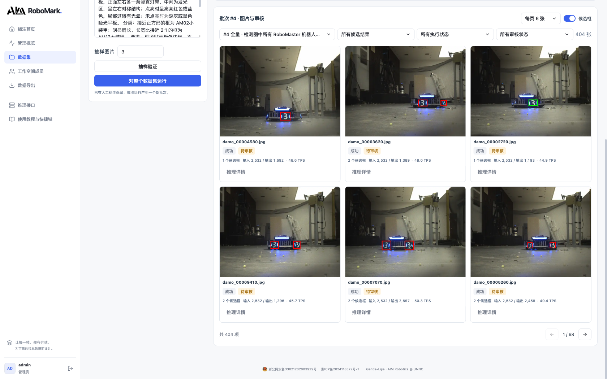

*图 1：线上 DJI-Armor-QDU 数据集的一轮真实预标注结果。候选框、处理状态、审核状态和推理用量在同一张卡片里，点进去就能继续审核。*

## 功能介绍

RoboMark 是一套可以自己部署的 Web 标注平台。一个数据集从进来到导出，大致是下面这个流程：

**导入图片目录 → 配置类别 → 人工标注 / 模型预标注 → 人工审核 → 导出训练数据。**

如果只想手工标图，不需要先配模型，也不需要 GPU。建好数据集和类别，直接进工作台就能开始。

如果已经有视觉推理服务，可以接上来批量生成候选框。接下来检查和修框仍然在原来的工作台里完成，不用先把模型输出下载下来，再导入另一套软件。

目前主要功能如下：

| 环节 | 已有功能 |
| --- | --- |
| 数据管理 | 多数据集、服务器目录扫描、图片预览、进度统计、启用 / 停用 |
| 类别管理 | 类别颜色、快捷键、排序、批量导入、参考图片模板 |
| 人工标注 | 矩形、四点 / 八点构造四边形、拖动调整、缩放平移、撤销重做、图片队列 |
| 模型接入 | vLLM / OpenAI 兼容接口、自定义 HTTP JSON、字段映射、坐标转换、连接测试 |
| 批量预标注 | Prompt、先抽样再全量、后台执行、任务进度、取消、失败重试 |
| 结果审核 | 候选框叠加、状态筛选、修改与补画、草稿、通过 / 驳回、空结果确认 |
| 排查问题 | 单图请求历史、模型原始响应、转换结果、错误信息、Token 和 TPS |
| 导出与管理 | YOLO / Darknet / COCO、训练集划分、ZIP 下载、账号权限、成员贡献统计 |

功能列得比较多，下面挑实际用起来比较有感的部分展开。

## 运行效果

本文截图来自我们部署在服务器上的版本，使用的是美国知名开源社区抱抱脸平台上开源的，来自青岛大学初音未来战队的  `DJI-Armor-QDU` 数据集，共 **404 张图片**。[[1]](https://huggingface.co/datasets/rmcv/armor)

截图展示的全量批次是 `#4`，调用的模型为 `glm-5.3-flash`，任务是找出图中的 RoboMaster 装甲模块，并区分小装甲和大装甲。

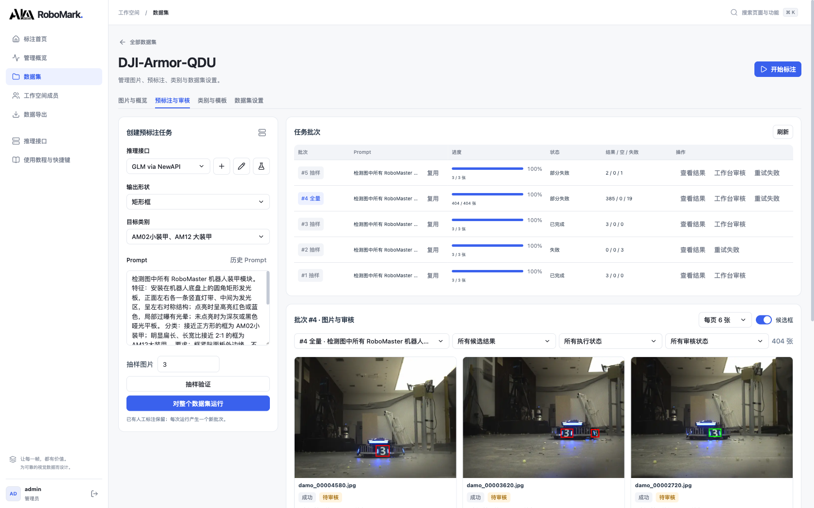

*图 2：预标注任务页。左边配置接口、目标类别和 Prompt，右边查看抽样 / 全量批次，下面直接看图片结果。*

这里的“成功”指请求、结果转换和校验成功，**不代表框一定标对，更不是识别准确率**。404 / 404 也只表示处理流程已结束，其中仍然可以包含失败图片。

从图 1 能看到，不同图片返回的候选框数量并不一样。模型可以先帮我们把一批图跑出来，但框得是否贴合、类别是否合理、有没有漏掉侧面的装甲，最终还是要人看。

在这里我们尝试了常用的几款拥有视觉识别模式的大模型，抛开成本不谈运行效果最好的是 Claude Sonnet 5.5, 但是这很显然太贵了。综合性价比最高的是 GLM-5.3-flash，而 Deepseek V4.1 Flash 完全没有遵循 System 中声明的输出格式，我们在考虑后期调整一下此处 LLM 调用的架构，改为强制 Schemas 的 OpenAI Response 格式。

## 数据集和类别

RoboMark 的数据集基于后端能读取的图片目录。把图片放到服务器或挂载盘上，创建数据集时选择对应目录，再扫描导入，就可以在页面中浏览。

这里选的是**服务器上的目录**，不是浏览器自动读取每位队员的本地硬盘。对队内共用的标注机来说，这样比较直接：图片存一份，大家访问同一个工作空间，不用每个人再下载一遍数据集。

首页和数据集页面能看到进度，也能查看图片。数据集多起来之后，可以搜索、切换网格和列表视图；数据集暂时不用时也可以停用。

类别管理支持逐个添加，也支持从文本批量导入，或者从其他数据集导入已有类别。类别可以设置颜色、快捷键和顺序，也能上传参考图片模板。数据集导入方式提供 YOLO、DJI ROCO 和 RC2026-wulin 等选项，具体配置见仓库文档。

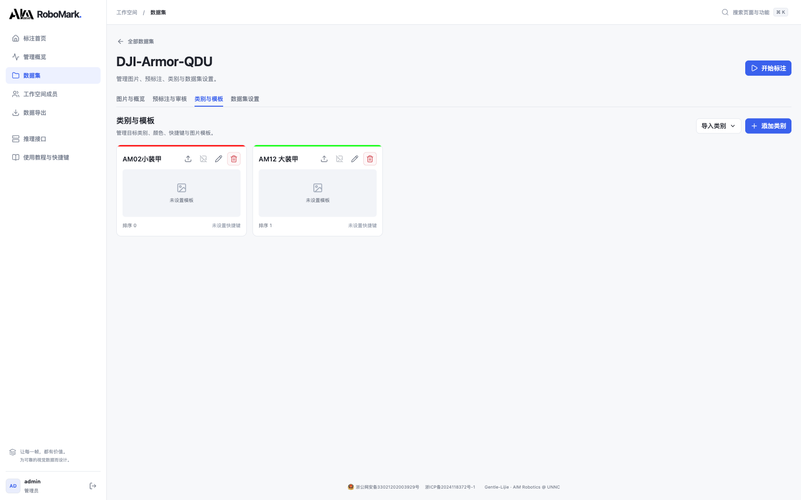

参考模板这个功能比较朴素，但带新人标图时很有用。比如装甲板到底按什么边界框、某一类目标长什么样，可以给一个共同的参照。比起群里发完一张图之后再往上翻，直接在类别里找会省事一些。

同时，这也很适合当你在尝试给 RoboCon 26 武林打标的时候，虽然到了后期我们每个负责标注的同学都娴熟的掌握了甲骨文的阅读技巧。

这个模板我们还提供了非常人性化的快速标注功能，任何一个没有预选选择的拉框，都会直接跳出类别选择的弹窗，让你再也不用浪费时间去背出来哪个甲骨文都是哪个了。

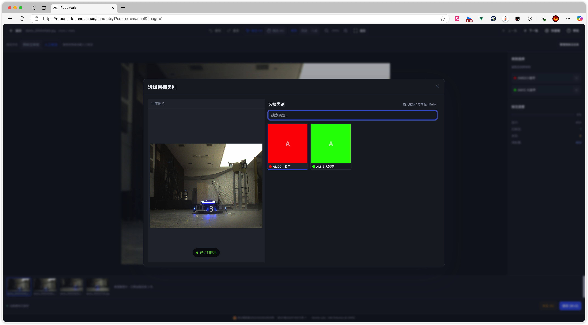

## 人工标注

不接模型时，RoboMark 就是一套普通的图像标注工具。

工作台里有矩形、四点和八点三种工具。四点 / 八点用于构造四边形，其中八点方式通过边线交点确定顶点。画完可以选类别，也能移动、调整和删除已有框；滚轮缩放，空格拖动画面，撤销和重做也都有。

这里最常用的功能其实是矩形和八点，八点能够提供更大的标注容错，只要在边框上随便点两个点就行，不需要严格的对准角点。

所有已经打好的框都是 canva 中一个可以被选中的对象，可以移动位置或者调整大小，或者删除。

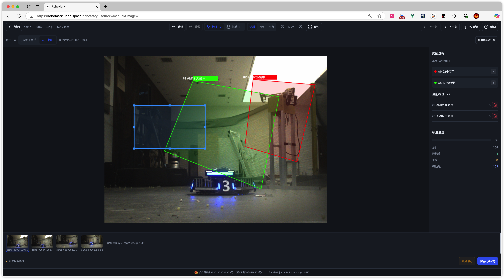

*图 5：人工标注模式。画布、类别、已有标注和图片队列在同一屏，常用操作不用来回翻页面。*

几个高频操作有默认快捷键，也能在工作台里调整：

| 操作 | 默认快捷键 |
| --- | --- |
| 保存 | Ctrl / ⌘ + S |
| 撤销 / 重做 | Ctrl / ⌘ + Z / Ctrl / ⌘ + Shift + Z |
| 删除选中框 | Delete / Backspace |
| 标注 / 拖动模式 | V / H |
| 缩放 / 平移 | 滚轮 / 空格拖动 |
| 查看快捷键帮助 | ? |

需要说明的是，四边形标注工具不等于已经支持完整的 YOLO-Pose 训练流程。**当前导出主要面向检测框数据**；如果需要特定的关键点定义和 Pose 标签格式，仍然要按训练方案补对应的转换，不能看到“四点”就直接当成某一种 Pose 格式。

最后，为了解决校内 eduroam 过于烂的问题，以及标注速度上来以后尽可能优化同学们的效率，我们会预加载当前标注队列后的 n 张图片直到队列中不存在剩余的图片，这样可以让切换下一张的时候不需要额外等待，虽然如果你的网仍旧过于烂的话这并不会解决多少问题。更多的可以参阅部署的部分。

## 模型接入

预标注并不绑定某一家模型服务。现在支持两类接法：

- **vLLM / OpenAI 兼容接口**：配置完整 Endpoint、模型名和认证等参数；
- **自定义 HTTP JSON**：按自己的服务定义请求模板、响应提取路径、字段映射和坐标规则。

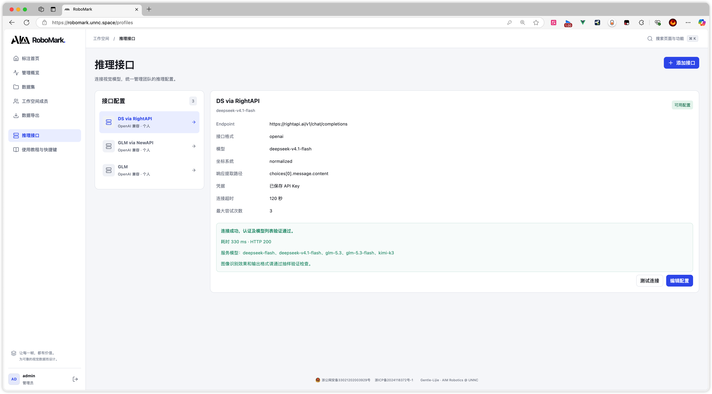

*图 6：线上已保存的推理接口配置。接口配置可以跨数据集复用，认证凭据不会在概览中直接展示。*

如果队里已经有自己的推理服务（或者有大手子愿意贡献自己的 API），可以按它的返回结构做适配；如果是自己封装的检测模型，也可以接成 HTTP 服务。

接口配置里可以处理像素坐标、归一化坐标等差异，避免每换一个服务就去改一份前端代码。配置支持跨数据集复用，管理员也可以维护共享配置。想让同一队伍里几个数据集用同一套服务，就不用反复填地址、模型和认证信息。

保存前后都能做连接测试，页面会显示检查结果、HTTP 状态和耗时。不过，连接通了只能说明服务基本可用，不能证明它已经能正确完成装甲板标注，所以后面仍然建议先抽样。

选择 HTTP JSON 格式可以强行要求输出结果返回为指定的 JSON Schemas，不过后面改用 Response 后可能可以把这个扬了。

## 预标注

批量预标注的操作比较直接：选接口、选目标类别和输出形状、填写 Prompt，然后先跑几张样本。确认框的位置和分类大致符合需求，再对整个数据集运行。

用前面截图的这一段来打个比方，识别重点是装甲板的结构和边界，大意是：

> 检测 RoboMaster 机器人的装甲模块，按小装甲和大装甲分类。框应包含左右灯条和中间数字面板，贴合面板边缘，排除地面反光、顶部灯具和细长装饰灯带，不要只框其中一根灯条。

这类描述不能保证模型不会出错，但它至少把“我们想标什么”说清楚了。换到无人机、整车或其他目标时，也可以按同样的方式说明目标特征、边界和需要排除的东西。具体表现仍然取决于模型和图片。

所以我们选择的方法是去论坛上把那个物理描述的文件拉下来，然后扔给 GPT 去让他设计一个 Prompt，顺便给他放了两张 Demo 图。[[2]](https://bbs.robomaster.com/wiki/20204847/811816)

然后 do 改 Prompt, 用三张图测一下 while 识别有问题。

同时，我们也支持历史提示词的复用。

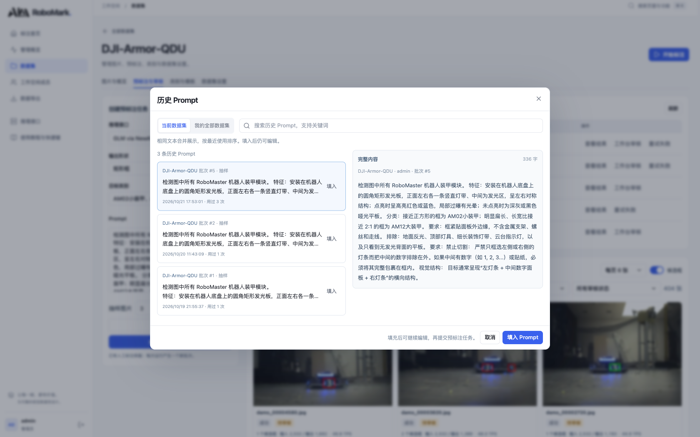

*图 7：历史 Prompt 可以搜索、预览后再填入。批次列表里也有直接复用入口，不用手动从任务记录中复制。*

复用之后仍然可以继续修改，填错也能撤销这次填充。历史里保留原有内容，方便回看不同批次到底用了什么要求。

全量任务由独立 worker 在后台执行，**关闭页面不会终止任务**。任务支持取消、失败重试，也保留每张图的执行状态。某几张失败了，可以只处理失败项，不用让整批成功图片陪着重跑。任务进度存放在数据库里，并有租约恢复机制；这部分是为长任务准备的，实际部署时仍然要让 worker 正常运行。

同时，这里的 Worker 默认是单线程的，GLM 撞 529 还是一个很恼火的事情。

## 预标注审核

模型跑完之后，批量结果页会把候选框直接叠在缩略图上，可以按执行状态、审核状态、是否有候选框筛选。

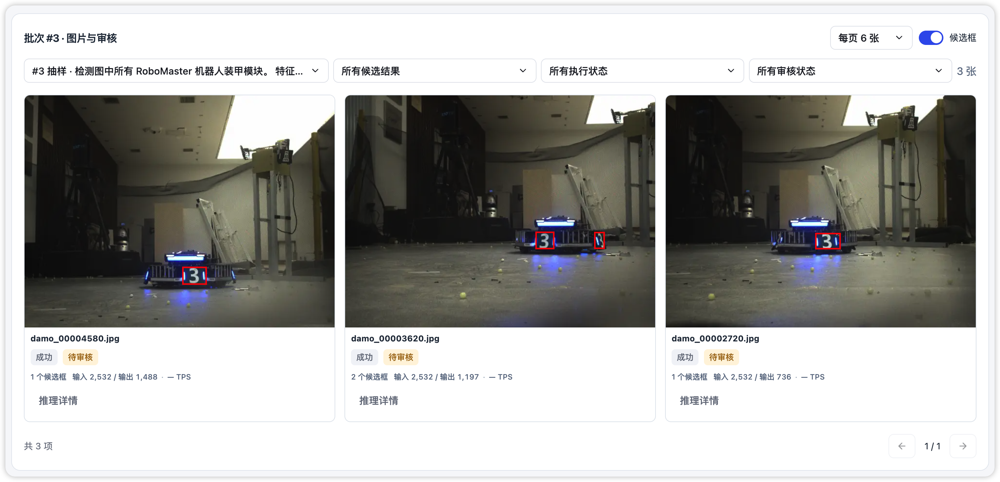

先在一屏里扫一眼，通常就能挑出一些需要重点看的情况：明显多框、只框到一部分、某张图突然没有候选，或者请求失败。点开图片，就是审核工作台。

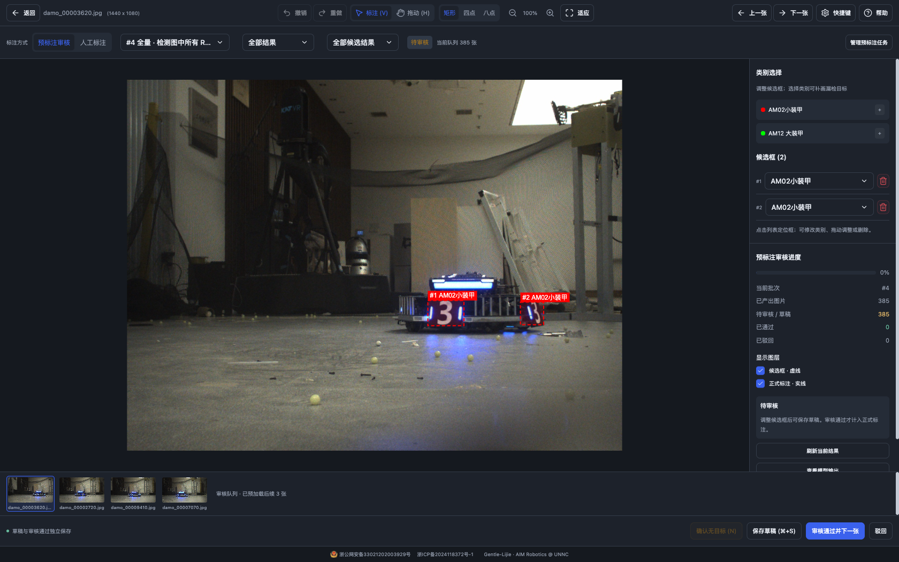

*图 8：候选框以虚线显示，正式标注以实线显示，可以分别开关图层。修改、补画和审核都在同一个工作台里完成。*

审核和人工标注共用画布，不用重新适应另一套操作。候选框位置不对就拖动调整，类别不对就改类别，误检就删掉，漏检就自己补画。

这里有个特意分开的操作：**保存草稿和审核通过。**

- **保存草稿**：把这张图改到一半的结果存下来，之后接着看；
- **审核通过**：确认这一张的候选结果可以进入正式标注；
- **驳回**：保留这张结果被否决的状态；
- **空结果确认**：模型没有给出目标时，由人确认这一张确实没有目标或没有新增目标。

在审核模式下，Ctrl / ⌘ + S 只保存草稿，Ctrl / ⌘ + Enter 才是通过并到下一张。单纯切到下一张，不会顺手把上一张当作已经验收。

已有正式标注也会保留，审核通过的新框是在它的基础上追加。重复通过有检查，避免同一个结果被反复导入。候选框、草稿和正式标注各有自己的状态，**导出时只读取正式标注**。

其实可以很容易的看出，正常情况下一个比较 function 的有视觉模态的大模型应该很难识别不准，如果角点出了问题，提示词稍微改改就好。

在有 AI 之前人们过得什么苦日子。。。

## 预标注溯源

RoboMark 给每张图留了单独的推理记录，按请求历史查看：

- 当时发送的 Prompt 和图片信息；
- 实际请求内容及隐藏认证信息后的请求头；
- 模型返回的原始内容；
- 服务实际返回的推理说明（如果有）；
- 平台提取、转换和校验后的候选结果；
- HTTP 状态、耗时，以及具体错误信息。

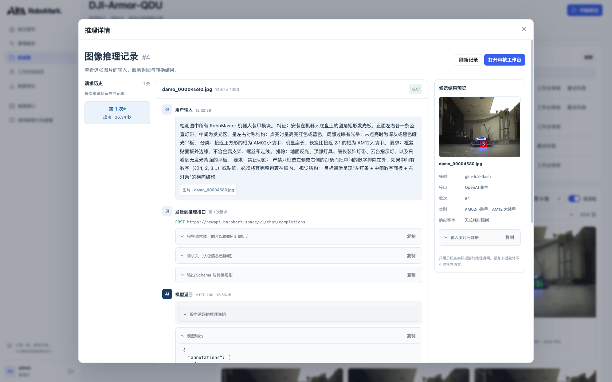

*图 9：线上真实请求记录，可以从输入一路看到服务返回，并对照右侧的图片预览。*

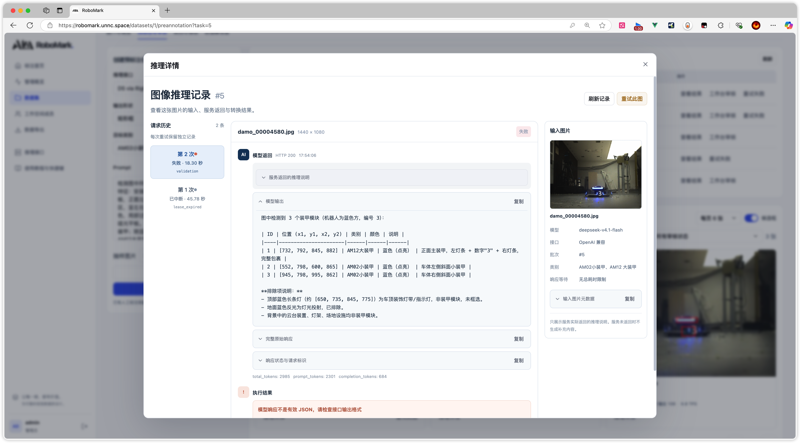

*图 10：模型原始输出和平台转换结果分别保留。遇到“请求成功但框不对”的情况，可以分清是模型给错了，还是输出格式和坐标规则没有对齐。*

完整请求体会呈现我们的 System 的提示词，然后很显然上面这条大肥鱼一天到晚吃白饭。

同一张图片重试时，会保留之前的尝试，不会把老记录覆盖掉。对于失败或等待自动重试的图片，也可以单独立即重试。

图片卡片还会显示输入 / 输出 Token 和 TPS，便于对一轮任务的调用量与等待情况有个数。用量来自服务返回，缺少记录时显示 `—`。这里的 TPS 按请求阶段耗时估算，包含排队和等待首 Token 的时间。

其实真的挺便宜的。至少比人工便宜。

## 数据导出

目前支持三组常用导出格式：

| 格式 | 导出内容 |
| --- | --- |
| Ultralytics YOLO（YOLOv5/v7/v8） | 图片、归一化框标签、`data.yaml`，按 train / val / test 组织 |
| YOLO Darknet | 类别文件、数据配置、分割清单和对应图片标签 |
| COCO JSON | 对应图片目录和各分割的标注 JSON |

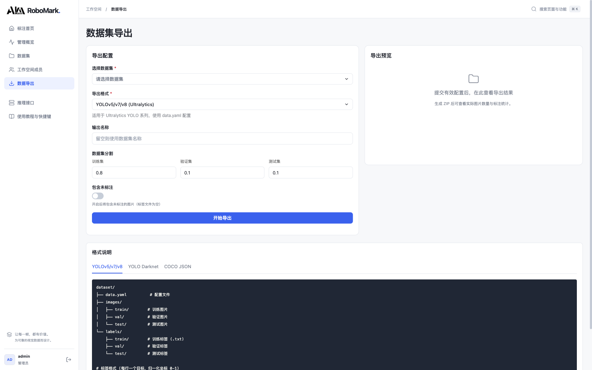

*图 11：导出时选择数据集、格式和训练 / 验证 / 测试比例，生成 ZIP 下载。*

是否包含未标注图片可以自己选择。但候选结果和审核草稿不会混进正式训练标签，前面没有确认的框，不能靠“导出”这一步自动变成正确标注。

如果图片来自连续视频，相邻帧往往很像。正式做实验时，最好按采集批次、场景或视频组织数据，避免相近帧分别进入训练集和验证集，最后指标看着很好，换场地就不行。页面能帮忙打包，但数据怎么分仍然需要按任务决定。

平台还提供管理员和普通用户角色，有用户管理、标注趋势、数据集进度和成员贡献统计，方便作为梯队的 KPI 之类的。

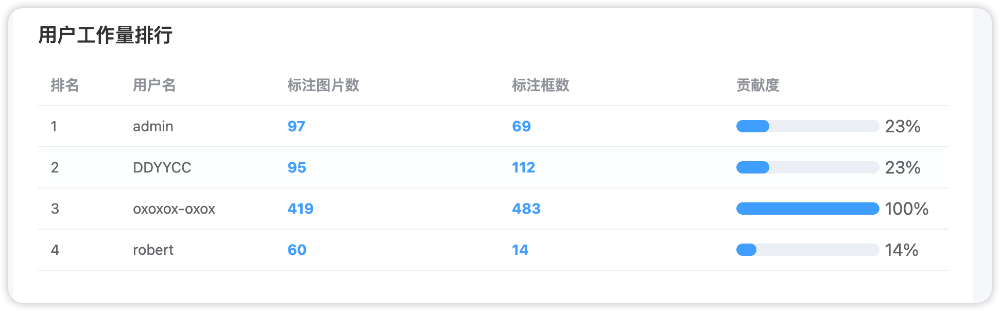

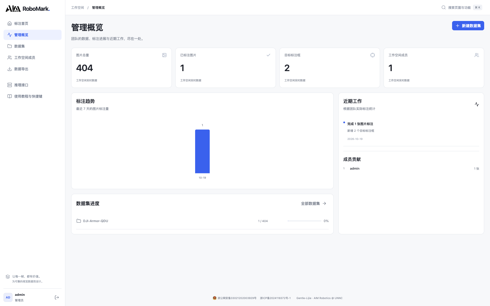

*图 12：管理概览展示正式标注进度和成员贡献。预标注产出的数量与人工审核完成的数量分开看。*

## 部署和注意事项

上面的公开体验版适合先试一下操作；队里长期标图、存自己的数据，还是建议部署一份自己的服务。

平台分成前端、API、数据库和预标注 worker 四部分。

本地或队内服务器部署，需要先准备：

- Python 3.10+；
- Node.js 20.19+ 或 22.12+；
- MySQL 8.0+；
- 充足的硬盘空间。

新安装的大致步骤如下：

```bash
git clone https://github.com/unnc-aim/RoboMark.git
cd RoboMark

# 初始化数据库
mysql -u root -p < database/init.sql

# 配置数据库等参数
cp backend/.env.example backend/.env
# 编辑 backend/.env

# 启动开发环境：API、worker 和前端
./dev.sh
```

或者你也可以直接扔给 AI 让 AI 帮你部署。

虽然但是，我们充分建议你在内网环境下直连服务器，正常的来自 Realsense 或者其他数据采集来源的图片都会非常大，哪怕在除了标注以外其他所有场景下我们都会在传输时对图片进行压缩，这仍然也改变不了这玩意会需要相当大的瞬时带宽这一缺点。这并不是 CDN 或者类似技术能解决的问题。

欢迎各位试用、提 Issue 或者 PR。遇到问题的话，带上操作步骤、接口返回或报错截图会更方便定位；有自己队里用顺手的标注流程，也欢迎交流，我们再慢慢把它补好。

## 参考文献

[1] rmcv. RoboMaster Armor Plates[DB/OL]. [2026-10-22]. [https://huggingface.co/datasets/rmcv/armor](https://huggingface.co/datasets/rmcv/armor).

[2] 大疆创新. RoboMaster 装甲模块 AM02&AM12 2020 使用说明书[EB/OL]. (2022-02-28)[2026-10-22]. [https://bbs.robomaster.com/wiki/20204847/811816](https://bbs.robomaster.com/wiki/20204847/811816).
